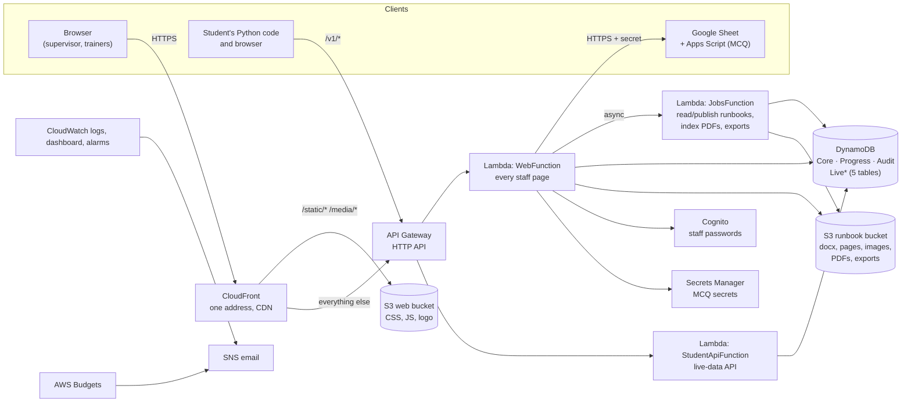
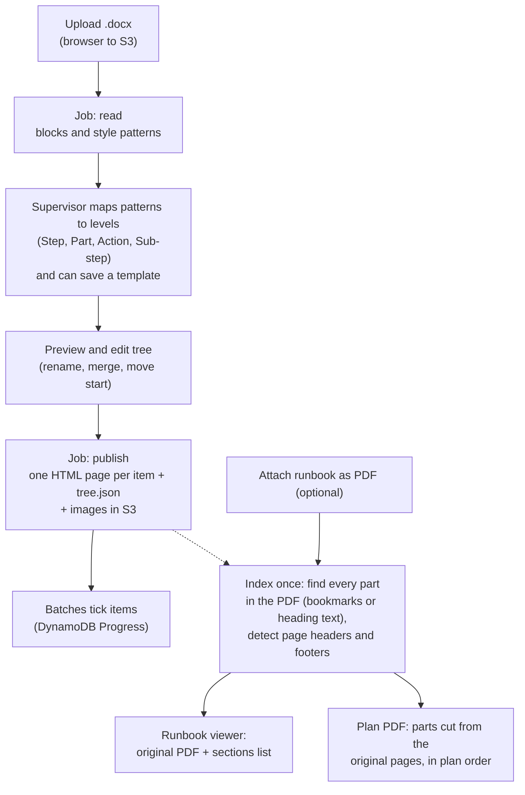

# SkillOps

**SkillOps** is an internal platform for running on-the-job (OJT) and skill-training programmes at any partner
institution. A supervisor sets up institutions, programmes, batches and trainers; trainers plan each class day from
the **runbook** (the Word/PDF delivery guide), teach from it, and tick off what the class has covered; students
practise on live data and take MCQ tests; everyone gets progress dashboards. It is a server-rendered Python web app
that runs on AWS serverless services (about zero cost while idle) and also runs entirely on a laptop with a fake AWS.

- [What it does](#what-it-does)
- [Architecture](#architecture)
- [Setup](#setup) (run it locally in five minutes, then deploy to AWS)
- [Project structure](#project-structure)
- [Working with runbooks and PDFs](#working-with-runbooks-and-pdfs)
- [Admin command line](#admin-command-line)
- [Documentation](#documentation)

---

## What it does

| Who | What they can do |
|---|---|
| **Supervisor** (admin) | Sets up the organisation: Robomy's *courses* and their *projects*, partner *institutions*, *programmes*, *batches* and *trainers*. Uploads runbooks, confirms their structure and publishes them. Monitors every batch on a dashboard (read-only), reads the audit log, exports and restores data. Manages live data feeds and MCQ connections. |
| **Trainer** | Sees only their own batches. Plans each class day on a calendar (drag runbook parts into a timeline, add breaks and notes), downloads the plan as a PDF, teaches the planned session, marks parts done (with notes and a class recap), reads the whole runbook as its original PDF with section navigation, creates live-data join codes and runs MCQ tests for the batch. |
| **Student** | Registers with a join code, practises against a live, time-released data feed through a small Python client, and takes MCQ tests from a link. Students never sign in to the staff app. |

Main features:

- **Organisation model:** Courses → Projects (a runbook per project); Institutions → Programmes → Batches; trainers linked to batches.
- **Runbooks:** a Word `.docx` is read, its structure is detected and mapped (headings, coloured bands, action IDs), previewed, edited and published. Each batch keeps its own ticks, notes and version; new versions carry ticks across by action ID.
- **Runbook PDF:** attach the runbook saved as PDF and it is indexed once; the runbook then opens as its original PDF (vertical scroll, sections list on the left) and session plans are cut straight out of it.
- **Session planner:** class days, one shared plan per batch per day, drag-and-drop timeline, conflict handling when two trainers edit, plan PDF export.
- **Teaching:** today's planned session, per-part *Mark done*, recap for students, progress dashboards per batch, programme and trainer.
- **Live Data Simulator:** a feed of rows released over time (with a controllable clock) for students to query.
- **MCQ tests:** connects each institution's Google Apps Script test system; open/close tests, live monitor, results, marks register.
- **Operations:** audit log of every write, CSV import, full export/restore, health page, CloudWatch alarms and a cost budget.
- **UI:** an AWS-console-style interface (white top bar, bordered containers, blue actions, status icons), light and dark themes, large "overlay" panes for the runbook and planner.

---

## Architecture

### System overview (AWS)



No server runs all the time and there is no VPC or NAT gateway, so the idle cost stays near zero. Large file uploads
(runbook `.docx`/`.pdf`) go straight from the browser to S3 with a pre-signed POST; the runbook PDF is returned as a
short-lived S3 link (it is too big for a Lambda response). Everything is described in one SAM template,
[`template.yaml`](template.yaml); see [docs/AWS_SETUP.md](docs/AWS_SETUP.md) for what each service is and what it costs.

### Local mode

`python local_server.py` runs the same page code on your laptop. [moto](https://github.com/getmoto/moto) provides a
fake AWS in memory (DynamoDB, S3, Cognito, Secrets Manager, Lambda), sign-in is a "choose a user" list, background jobs
run in a thread, and everything disappears when you stop the server. The test suite uses the same fake AWS.

### How a request is handled

1. CloudFront passes the request to API Gateway, which invokes `WebFunction` (`src/web_app.py` → `skillops/web.py`).
2. The router finds the route (each page is a function marked with `@route(method, pattern, access=...)`).
3. It checks the sign-in cookie (Cognito-backed session), the **role** (`public` / `staff` / `super`) and, for batch
   pages, that this trainer belongs to that batch.
4. For a `POST` it also checks the request came from this site (origin) and carries the CSRF token; every write is
   written to the **audit log** with who, what and the result.
5. The page function reads and writes DynamoDB / S3 through `skillops/core/store.py`, then renders a **Jinja2**
   template. Errors become a plain page with a request ID; the details go only to CloudWatch.

### Code layout (layers)

| Package | Responsibility |
|---|---|
| `skillops/web.py` | Router, request context (`ctx.render`, `ctx.redirect`), navigation and breadcrumbs, security headers |
| `skillops/pages/` | The pages, grouped by area: `home`, `admin_org`, `admin_people`, `runbooks`, `plans`, `teach`, `monitor`, `live`, `mcq`, `auth_pages`, `admin_misc` |
| `skillops/core/` | Settings, DynamoDB/S3 access (`store`), sign-in (`auth`), permissions (`perms`), organisation model (`org`), audit, export/restore, CSV import, background jobs, idempotency, HTML helpers, and a small PDF writer (`pdf`, `pdfhtml`) |
| `skillops/runbook/` | `.docx` reader, structure detector, tree builder, HTML renderer, ticks and progress, versions, and the PDF indexer/slicer (`pdfslice`) |
| `skillops/planner.py`, `classdays.py` | Session plans (optimistic revision, overlap and missing-part checks, PDF export) and class-day calendars |
| `skillops/dashboard.py` | Progress aggregation for the supervisor and trainer dashboards |
| `skillops/livedata/` | The Live Data Simulator engine: feeds, clock, rows, join codes, students, rate limits, student API |
| `skillops/mcq/` | Client for the MCQ Apps Script system (and a fake one for the laptop) |
| `templates/`, `static/` | Jinja2 templates; one stylesheet and plain JavaScript (`app.js`, `planner.js`, `rbview.js`); logos and icons |

The front end is server-rendered HTML with a little progressive JavaScript: no build step, no framework, no external
fonts or scripts (the Content-Security-Policy only allows this site).

### Runbook pipeline



Parts missing from the PDF fall back to a page laid out from the published HTML, so a plan is never incomplete.

### Data model (DynamoDB, on-demand, point-in-time recovery on)

| Table | Contents (partition key → sort key) |
|---|---|
| `Core` | Courses, projects, institutions, programmes, batches, trainers and their links, runbooks, versions, mapping templates, jobs, sessions, session plans (`PLAN#<batch>` → date), class days |
| `Progress` | Ticks `I#<item>`, notes `N#<item>` per batch and runbook version, and an event stream `EVT#<batch>` for the activity feed |
| `Audit` | One partition per month (`AUDIT#yyyy-mm`), sorted by time |
| `Live*` (5) | Live-data rows, feeds and join codes, students, fetch log, rate limits |

### Security

- Staff sign in with **Cognito** passwords (own sign-in page; password rules and reset flows); students use join codes and
  per-student API keys (stored hashed).
- Role checks on every route; trainers are limited to their batches; the supervisor can only *view* batch work
  (ticks, notes and plans are trainer-only, enforced on the server).
- CSRF token and same-origin check on every `POST`; strict CSP, `X-Frame-Options: SAMEORIGIN`.
- Buckets are private (CloudFront reads only `static/` and `media/`); runbook files are served by short-lived signed links.
- Secrets live in Secrets Manager, never in code or exports; every write is audited.

---

## Setup

### Requirements

- Python **3.12** or newer, and `git`
- For deploying: AWS CLI v2, AWS SAM CLI, Docker (details in [docs/AWS_SETUP.md](docs/AWS_SETUP.md))

### Run it on your laptop (no AWS account)

```bash
git clone https://github.com/brrikcy/skillOps.git
cd skillOps

python -m venv .venv
# Windows:  .venv\Scripts\activate        macOS / Linux:  source .venv/bin/activate
pip install -r requirements-dev.txt -c requirements-dev.lock

python -m pytest                      # the automatic tests (fake AWS, takes a few minutes)
python local_server.py --seed         # the app with sample data at http://127.0.0.1:8790
```

Open <http://127.0.0.1:8790>. The sign-in page lists local users (a supervisor and four trainers); pick one. Stop the
server with `Ctrl+C`: everything in a local run is discarded.

Useful variants:

| Command | What it does |
|---|---|
| `python local_server.py` | Empty system (no sample data) |
| `python local_server.py --seed` | Sample institutions, batches, trainers, live-data feed, MCQ fake, class days and a plan |
| `python local_server.py --seed --sample` | The above plus a lot of temporary sample data (progress over weeks, plans, students, audit log) |
| `python local_server.py --port 8795` | Another port |
| `python demo.py` | A one-minute console demonstration of who sees what |

Set `SKILLOPS_SAMPLE_RUNBOOK` to the path of a runbook `.docx` to load it as the sample "Airtel" runbook with `--seed`
(an optional PDF with the same name beside it is attached too). Without it, the seed skips the runbook part, and the
few tests that need a real runbook are skipped.

### Deploy to AWS

```bash
sam build --use-container
sam deploy --guided        # first time; then just: sam deploy
```

The guided deploy asks for the platform name, the supervisor's email and name, an alarm email and a monthly budget.
It prints `WebUrl` when done; the supervisor receives a temporary password by email. Full, step-by-step instructions
(installing the tools, AWS credentials, answers to the guided questions, custom domain, first sign-in, export/restore,
deleting the stack) and what each AWS service costs are in **[docs/AWS_SETUP.md](docs/AWS_SETUP.md)**.

Template parameters (`template.yaml`): `PlatformName`, `LiveDataName`, `SuperadminEmail`, `SuperadminName`, `AlarmEmail`,
`MonthlyBudgetUSD`, `RateLimitPerMinute`, `PageSize`, `FetchLogDays`, `PracticeDataset`, `SessionHours`, `WebDomainName`,
`WebCertificateArn`.

### Configuration at runtime

Settings come from environment variables set by the template (table names, bucket names, Cognito pool, secret ARNs).
On a laptop `local_server.py` sets safe fake values. `SKILLOPS_LOCAL=1` marks local mode (it enables the "sign in as" list and
must never be set in AWS).

---

## Project structure

```
template.yaml          AWS infrastructure (SAM): tables, buckets, Cognito, Lambdas, CloudFront, alarms, budget
src/
  web_app.py           Lambda entry point: every staff page
  student_api.py       Lambda entry point: the live-data student API (/v1/...)
  jobs.py              Lambda entry point: background jobs (read/publish runbooks, PDF index, export)
  publisher.py         Deploy helper: copies static files to S3, empties buckets on delete
  requirements.txt     Exact runtime package versions (AWS)
  skillops/            The application (see "Code layout")
  templates/           Jinja2 page templates
  static/              Stylesheet, JavaScript, logos, icons
  public/              Public student pages (register, developer docs, status)
appsscript/Api.gs      The one file added to each institution's MCQ Apps Script project
reference/             Reference client and example page for live data (students' side)
admin.py               Command line: export/restore, CSV import, live-data upload and clock
local_server.py        The whole app on a laptop with a fake AWS
demo.py, demo_rich.py  Sample data for local runs
tests/                 ~200 automated tests (pytest + moto)
tools/make_logo.py     Rebuilds the dark-mode logo from the master logo
docs/                  AWS guide and design/review notes
ADMIN_GUIDE.md         Guide for the supervisor
TRAINER_GUIDE.md       One-page guide for trainers
```

---

## Working with runbooks and PDFs

1. **Runbooks → Add a runbook**, then upload the Word `.docx` (up to 40 MB). It is read in the background.
2. **Map** the structure it found (choose a level per pattern; save the layout as a template), **Preview**, then **Publish**.
3. Choose the runbook for a project on its course's page. Batches stay on their version until moved.
4. *(Recommended)* On the runbook's page press **Attach PDF** on a version, using the runbook saved from Word as PDF
   (keep "Create bookmarks using Headings" on). It is matched to the published pages (shown as "N of N pages found").
   From then on the runbook opens as its original PDF and plan PDFs are cut from it. Re-attach after changing the Word file.

Details for each screen are in [ADMIN_GUIDE.md](ADMIN_GUIDE.md).

## Admin command line

`admin.py` runs on your computer with your AWS credentials (trainers never need any):

```bash
python admin.py outputs                       # show the stack outputs (URLs, table names)
python admin.py export --out backup.zip       # everything to a .zip (CSV + JSON)
python admin.py restore --file backup.zip     # write an export back (--overwrite to replace)
python admin.py import-csv --file setup.csv   # institutions, programmes, batches, trainers from CSV
python admin.py inspect --db data.db          # look at a .db/.csv before loading it as live data
python admin.py upload --db data.db --mapping datasets.json --feed uber --go-live "2026-11-16 09:00"
```

Run `python admin.py --help` for all commands (activate/deactivate datasets, clock, feeds, account sync).

## Documentation

| Document | For |
|---|---|
| [TRAINER_GUIDE.md](TRAINER_GUIDE.md) | Trainers: plan, teach, mark done, read the runbook |
| [ADMIN_GUIDE.md](ADMIN_GUIDE.md) | The supervisor: set-up, runbooks, live data, MCQ, export |
| [docs/DEPLOY_WITH_GITHUB.md](docs/DEPLOY_WITH_GITHUB.md) | Deploy from GitHub without signing in to AWS yourself (one set-up step by an administrator) |
| [docs/AWS_ADMIN_NOTE.md](docs/AWS_ADMIN_NOTE.md) | For the AWS administrator: the one role to create so GitHub can deploy |
| [docs/AWS_SETUP.md](docs/AWS_SETUP.md) | AWS services, costs, install, deploy, custom domain, backup |
| [docs/REVIEW-2026-11-10.md](docs/REVIEW-2026-11-10.md) | Review notes behind the second build round |

## Status

Built and tested on a laptop with a fake AWS (about 200 automated tests). **Not yet deployed to AWS.**
Licence: not yet chosen.
